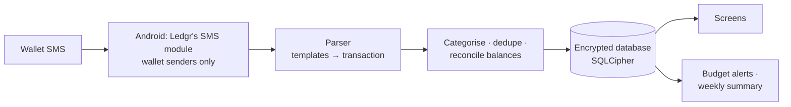

<div align="center">


# Ledgr

**Your mobile money SMS, turned into a spending record. On your phone, and only there.**

[](https://github.com/CollinsWoelinam/Ledgr/actions/workflows/ci.yml)    

[Features](docs/features.md) · [How it works](docs/architecture.md) · [Privacy](docs/privacy-policy.md) · [Development](docs/development.md) · [Changelog](CHANGELOG.md)

</div>

---

Every MTN MoMo and Telecel Cash transaction already arrives as an SMS: the amount, the fee, the e-levy and your new balance. Ledgr reads those messages on the phone, records each one, sorts it into a category and tracks it against your budgets, so you see where your money went without typing anything in. Nothing is uploaded: there's no account and no server, and your SMS never leave the device.

## What it does

<table>
<tr>
<td width="50%" valign="top">
<br>
<b>Reads your wallet SMS</b><br>
Imports your history on first launch, then records new transactions within seconds, with fee, e-levy and balance. Only wallet senders are read; other messages are never touched.
</td>
<td width="50%" valign="top">
<br>
<b>Accounts for every cedi</b><br>
Checks each wallet's balances against its transactions and flags money that moved with no SMS, naming a likely cause where it can: an airtime top-up, or a round amount plus your usual charges.
</td>
</tr>
<tr>
<td valign="top">
<br>
<b>Sorts itself</b><br>
Twelve categories out of the box. Correct one and choose “apply to all”, and everything from that person or shop follows, now and later.
</td>
<td valign="top">
<br>
<b>Budgets that keep pace</b><br>
A monthly limit overall or per category, measured against how far through the month you are. The month can start on payday.
</td>
</tr>
<tr>
<td valign="top">
<br>
<b>Tells you in time</b><br>
A notification when a budget reaches 80% and 100%, even while Ledgr is closed, and a weekly summary every Sunday evening.
</td>
<td valign="top">
<br>
<b>Shows the pattern</b><br>
Spending by category, day by day and month by month, your top recipients, and what you paid in fees and e-levy. Per wallet or all together.
</td>
</tr>
<tr>
<td valign="top">
<br>
<b>Cash, too</b><br>
Record what you spend in cash. It moves out of “Cash withdrawals” into its real category, so nothing is counted twice.
</td>
<td valign="top">
<br>
<b>Fill the gaps yourself</b><br>
Add a transaction that never got an SMS. If the SMS turns up later, it replaces your entry and keeps your category.
</td>
</tr>
<tr>
<td valign="top">
<br>
<b>Business or personal</b><br>
Mark transactions, or everyone you trade with, as business, and see the two flows apart.
</td>
<td valign="top">
<br>
<b>Take it with you</b><br>
Export any period to CSV for a spreadsheet, or to a PDF statement, through your phone's share menu.
</td>
</tr>
<tr>
<td valign="top">
<br>
<b>Private by design</b><br>
An encrypted database with its key in Android Keystore, fingerprint or PIN lock, and amounts hidden on a secure lock screen.
</td>
<td valign="top">
<br>
<b>Works offline</b><br>
No sign-up, no internet needed, no ads or trackers. Light and dark themes, following your phone until you choose.
</td>
</tr>
</table>

See **[the feature guide](docs/features.md)** for how each one behaves.

## Supported wallets

| Wallet | SMS sender | Message formats | Statement code |
| --- | --- | --- | --- |
| MTN MoMo | `MobileMoney` | 14, from 1,800+ real messages | `*170#` |
| Telecel Cash | `T-CASH` | 8 | `*110#` |
| AT Money | — | Planned | — |

Formats live in versioned JSON templates, so new message wording can be taught without changing the app's code. Messages Ledgr can't read yet go to **Needs review** instead of being dropped.

## How it works



Everything in this chart runs on the phone. When a wallet SMS arrives while Ledgr is closed, Android starts it briefly in the background to do the same work. More in **[How it works](docs/architecture.md)**.

## Privacy at a glance

- **SMS stay on the phone.** Ledgr reads only messages from wallet senders; nothing is sent anywhere.
- **Encrypted at rest.** The database is SQLCipher-encrypted with a random key held in Android Keystore.
- **You decide what leaves.** The only way data leaves Ledgr is an export you share yourself, and an export never includes SMS text.
- **One tap to erase.** *Delete all data* removes everything Ledgr stored.

The full **[privacy policy](docs/privacy-policy.md)** explains each permission and why it's needed.

## Status

| | |
| --- | --- |
| **Built and verified on a Galaxy A32** | SMS import and live sync · balance reconciliation · categories · budgets and alerts · weekly summary · insights · manual and cash entries · business tags · export · app lock · encrypted database |
| **Next** | Encrypted backup (US-12), a client-side encrypted file that only your passphrase opens |
| **Tests** | 143 unit tests, plus 159 anonymised SMS fixtures that every parser change must pass |
| **Performance** | Cold start to dashboard in 1.0–1.5 s with 1,900+ transactions; first import of 3,300+ SMS in about 10 s |

## Get started

```sh
npm install
npm test                 # parser + app tests
cd apps/mobile
npx expo start --go      # try it in Expo Go, on demo data
```

Reading real SMS, encryption and notifications need a development or release build (`npx expo run:android`). The **[development guide](docs/development.md)** covers setup, the parser workflow, release builds and publishing.

## Repository layout

```
apps/mobile/                 The app: React Native (Expo) with TypeScript
  src/app/                   Screens (expo-router): onboarding, five tabs, review, export…
  src/features/              Logic by feature: sms, reconcile, budgets, insights, cash, export, notifications…
  src/db/                    Encrypted database: migrations and repositories
  modules/ledgr-sms/         Kotlin: inbox reader, live and background SMS receivers
  plugins/                   Expo config plugins (release signing)
packages/parser/             The SMS parser: pure TypeScript, no app dependencies
  templates/                 Message formats per wallet (JSON)
  fixtures/                  Anonymised SMS with expected results: the parser's test suite
services/backup-api/         Planned: storage for encrypted backups
docs/                        Feature guide, architecture, privacy, development, decisions
```

---

<div align="center">
<sub>Built from the <a href="MoMo%20Expense%20Tracker%20—%20PRD.md">product requirements</a> · <a href="CHANGELOG.md">Changelog</a> · <a href="docs/decisions">Decisions</a></sub>
</div>
