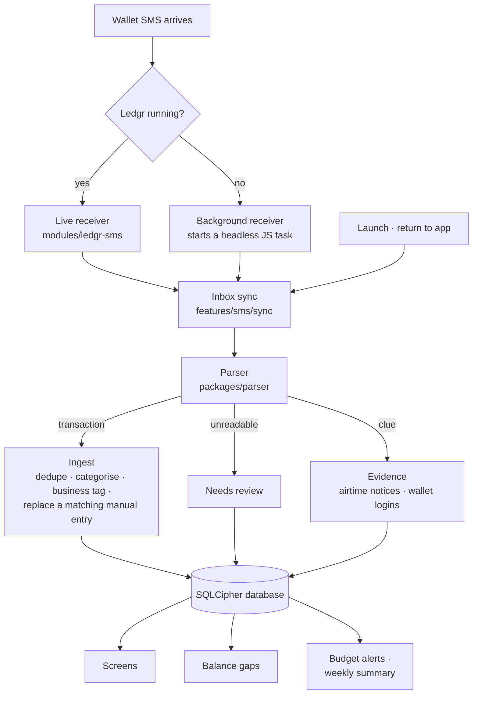

# How it works

Ledgr is an Expo (React Native) app in TypeScript with one small Kotlin module for SMS. Everything runs on the phone; there is no server.

## From SMS to screen

1. **Reading.** `modules/ledgr-sms` (Kotlin) reads the inbox for wallet senders only, oldest first from a saved position. While the app runs it listens for new SMS; otherwise a receiver declared in the manifest starts `LedgrHeadlessService`, which runs the same sync in JS with no screen. Only the sender IDs the app registered wake it.
2. **Parsing.** `packages/parser` is pure TypeScript with no app dependencies. Each wallet has JSON templates (named-group regular expressions with `{amount}` and `{cur}` macros). A message becomes a transaction, a clue (*evidence*), or a review item; failed and promotional messages are recognised and ignored. A hash of the templates triggers a one-time re-read when they change.
3. **Ingesting.** Transactions are deduplicated by provider and transaction ID, categorised (user rules → counterparty memory → keywords → type), tagged business if the counterparty is, and an SMS replaces a matching manual entry (same wallet, direction and amount within three days).
4. **Storing.** One SQLCipher database is the source of truth, with versioned migrations (v1–v5). The in-memory store (Zustand) writes every change through to it.
5. **Using it.** Screens, balance reconciliation, budget alerts and the weekly summary all read from the same store.

## Pieces

| Part | Where | Notes |
| --- | --- | --- |
| Parser | `packages/parser` | Templates per wallet, provider settings (senders, ignore/failed/evidence rules), dedupe keys. Tested against anonymised real SMS in `fixtures/`. |
| SMS module | `apps/mobile/modules/ledgr-sms` | Inbox reader, live receiver, background receiver and headless service. |
| Database | `apps/mobile/src/db` | Encrypted with a random key in Android Keystore (`expo-secure-store`). Opened once per process, shared by the app and the background task. |
| State | `apps/mobile/src/state` | The ledger (transactions, categories, rules, budgets, review, gaps, evidence) and settings (preferences only, never financial data). |
| Reconciliation | `src/features/reconcile` | Walks each wallet's balances; nets out late SMS; names likely causes from evidence and learned charges. |
| Notifications | `src/features/notifications`, `budgets`, `insights` | Local only. Budget thresholds are remembered per budget month; the next four weekly summaries are rescheduled whenever data changes. |
| Export | `src/features/export` | CSV and an HTML statement printed to PDF, shared through the system share sheet. |

## Rules worth knowing

- **Money is integers.** Amounts are stored in pesewas (minor units), never floating point.
- **Every outflow is spending**, cash-outs and bank transfers included; fees are tracked separately. Recorded cash spending draws down the most recent earlier cash-out instead of adding to the total.
- **Nothing is dropped.** A wallet message the parser can't read is kept for review, and a balance change no message explains is flagged.
- **SMS text stays inside Ledgr.** It's kept for the transaction detail screen and never exported, logged or sent.

## Decisions

Architecture decisions are recorded in [`decisions/`](decisions). The [PRD](../MoMo%20Expense%20Tracker%20—%20PRD.md) has the original requirements, referenced in the code as `US-…` and `FR-…`.

---

[README](../README.md) · [Features](features.md) · [Privacy](privacy-policy.md) · [Development](development.md)
