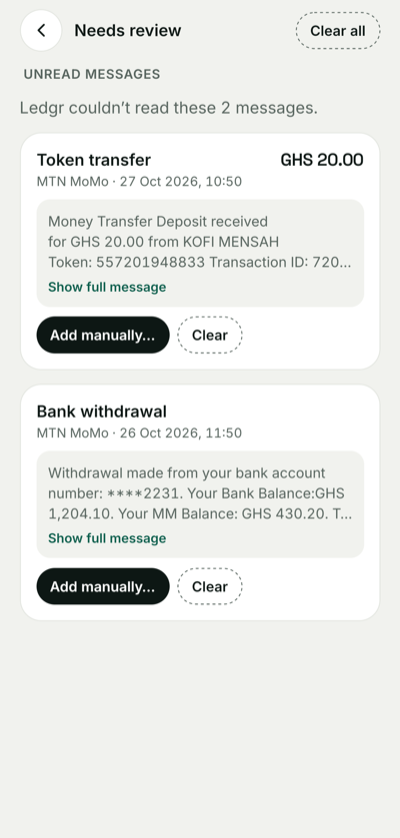
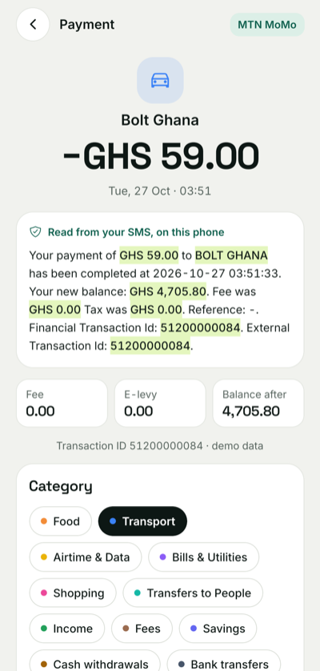
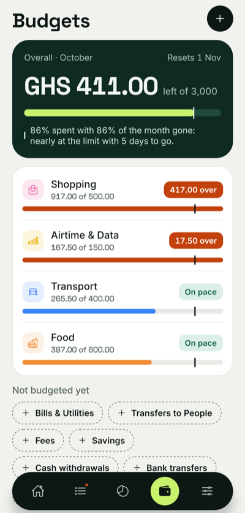
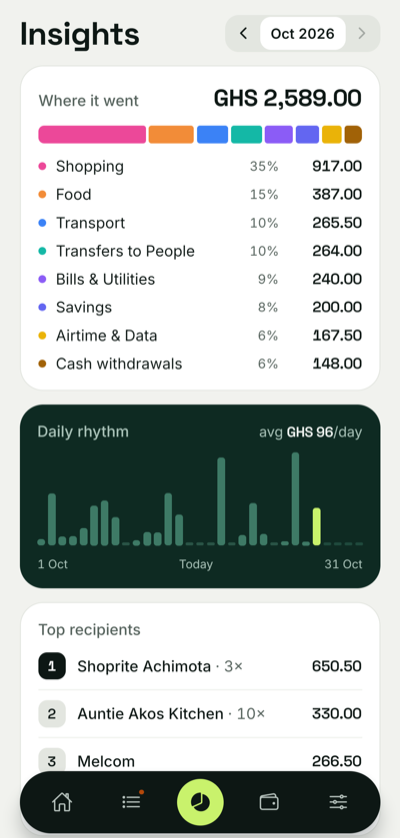

# Feature guide

How each part of Ledgr behaves, and the rules behind the numbers. For the short version, see the [README](../README.md).

**Contents:** [Reading SMS](#reading-your-wallet-sms) · [Every cedi](#accounting-for-every-cedi) · [Categories](#categories) · [What counts as spending](#what-counts-as-spending) · [Budgets](#budgets) · [Notifications](#notifications) · [Insights](#insights) · [Manual and cash](#manual-entries-and-cash) · [Business](#business-or-personal) · [Export](#export) · [Security](#security-and-privacy) · [Settings](#everything-else)

---

##  Reading your wallet SMS

<picture><source media="(prefers-color-scheme: dark)" srcset="assets/screens/dark/review.png"></picture>

- **First launch.** Ledgr explains why it needs SMS access before Android asks. Once allowed, it reads your wallet history and shows what it found. Without the permission you can explore it on demo data and allow SMS later.
- **Only wallet senders.** Ledgr asks Android for messages from `MobileMoney` (MTN MoMo) and `T-CASH` (Telecel Cash) only. Other messages are never read.
- **Staying current.** New transactions are picked up within seconds of the SMS, when you open Ledgr, and when you return to it. While Ledgr is closed, Android starts it briefly in the background for a wallet SMS, so budgets and alerts stay up to date.
- **No duplicates.** MTN sometimes sends two messages for one transaction; each transaction is recorded once, by its transaction ID.
- **Better reading over time.** When Ledgr learns a new message format, it re-reads your inbox once, so older messages in that format are recorded too.
- **Needs review.** A wallet message Ledgr can't read yet isn't dropped. It waits in **Needs review** with a short summary ("Money in · GHS 20.00") and the full text on request. **Add manually…** turns it into a transaction, pre-filled from the message; **Clear** removes it from Ledgr (your SMS inbox is never changed).

 

##  Accounting for every cedi

Every wallet SMS reports your new balance, so each balance should equal the previous one plus what happened since. When it doesn't, money moved without a message explaining it. Ledgr shows these as **money that moved with no SMS**, with the working laid out: the earlier balance, what the messages in between explain, what the balance should be, and what the wallet reported.

- **Not false alarms.** Messages that arrive out of order within half an hour are re-ordered, and SMS delivered hours late (which leave changes that cancel out within a day) aren't flagged.
- **Likely cause** *(green)*: MTN sometimes sends only the network's "Airtime recharged" notice without the MoMo receipt. When those notices add up to exactly what's missing, the card says so.
- **Could be** *(amber)*: a gap like −121.20 is usually a round amount plus charges, here a GHS 120 cash-out at 1%. Ledgr learns each wallet's charges from your own transactions within a year, of a similar size, and seen at least twice; the guess must match to the pesewa and is only offered above GHS 10. It's a guess, and the card says so.
- **Other clues.** If you signed in to your wallet during the gap, the card mentions it (app transactions don't always get an SMS). It also gives the statement code (`*170#` MTN, `*110#` Telecel) and dates to check.
- **Record it…** adds the missing transaction, pre-filled from the likely cause where there is one (name, category, time, and charges split out under Fees).
- **Ignore** hides the card. Ignored changes are listed at the bottom of Needs review and can be **restored**.

##  Categories

<picture><source media="(prefers-color-scheme: dark)" srcset="assets/screens/dark/detail.png"></picture>

Twelve to start: Food, Transport, Airtime & Data, Bills & Utilities, Shopping, Transfers to People, Income, Fees, Savings, Cash withdrawals, Bank transfers and Other.

- **How a transaction is sorted**, first match wins: your own rules, then what you chose before for that person or shop, then keywords (e.g. "ECG" → Bills), then the transaction type (a cash-out → Cash withdrawals).
- **Correcting.** Pick a new category on a transaction. With **Apply to all from …** on (the default), everything from them moves too, and their future transactions follow.
- **Your own.** Create, rename, recolour and delete categories. Deleting one moves its transactions to Other.

 

## What counts as spending

Once money leaves a wallet it counts as spent: payments, transfers to people, bank transfers and cash-outs. Fees and e-levy are shown separately (on Home, Insights and each transaction) and aren't added to category totals or budgets. Cash you record re-sorts cash withdrawals rather than adding to them ([below](#manual-entries-and-cash)).

##  Budgets

<picture><source media="(prefers-color-scheme: dark)" srcset="assets/screens/dark/budgets.png"></picture>

- **Overall, per category, or both**, each a monthly limit across all wallets.
- **Your month.** The budget month can start on any day from the 1st to the 28th, to match payday (Settings › Month starts on).
- **Pace, not just totals.** Each budget is compared with how much of the month has passed: **On pace**, **Ahead of pace** (spending faster than the month), **Nearly** (80% used) or **Over**. Home shows the overall budget with a daily allowance for the rest of the month, and your two fullest category budgets.

 

##  Notifications

All notifications are created by the phone itself. Nothing is sent from a server.

- **Budget alerts.** One at 80% ("Airtime & Data budget 84% used · GHS 2.00 left…") and one at 100%, per budget per month. Setting or editing a budget doesn't trigger an alert for a level you can already see. Tapping one opens Budgets.
- **Even while closed.** A wallet SMS wakes Ledgr briefly in the background, so an alert arrives as soon as the money moves. On Samsung phones, keep Ledgr out of *Sleeping apps* (Settings › Battery › Background usage limits) for this to work.
- **Weekly summary.** Sunday evenings around 7 pm (Android may deliver it up to an hour later to save battery), covering Monday to Sunday: what you spent, where most went, the change from last week, money in and how your budgets stand. It's updated whenever a transaction arrives, so it's current when it goes out. Tapping it opens Insights.
- **Your choice.** Both have a switch in Settings. Amounts are hidden on a secure lock screen.

##  Insights

<picture><source media="(prefers-color-scheme: dark)" srcset="assets/screens/dark/insights.png"></picture>

Browse any month back to your first transaction: where the money went by category, daily spending, your top recipients, and fees and e-levy paid. Once anything is marked business, a business/personal split appears. The wallet switcher (All wallets, MTN MoMo, Telecel Cash, Cash) narrows Home, Activity and Insights to one wallet; budgets always cover all of them.

 

##  Manual entries and cash

Add a transaction from **Activity › +**: money out or in, the amount, the wallet, what it was, the category, the day and, for MoMo, any charges.

-  **Cash** is a wallet of its own. A cash-out already counts as spending under Cash withdrawals, so recording what you bought with that cash would count it twice. Instead, cash spending draws down your most recent earlier cash-out: the total stays the same and the amount moves into its real category (a GHS 50 lunch moves GHS 50 from Cash withdrawals into Food). Cash you spend beyond your withdrawals, such as cash you were given, counts in full.
- **A MoMo transaction with no SMS** can be added on its wallet; it closes the balance gap it explains. If the SMS arrives within three days with the same wallet, direction and amount, the SMS replaces your entry and keeps your category.
- **Edit or delete** anything you added (recorded gaps included) from its detail screen. Transactions read from SMS can't be deleted: the SMS is the record.

##  Business or personal

Everything is personal unless marked **Business**, on a transaction or when adding one. With **Apply to all from …** on, everyone you trade with stays business for future transactions too. Activity gets a **Business** filter, Insights a business/personal split, rows show "Business" beside the category, and exports include it.

##  Export

**Settings › Export CSV or PDF.** Choose a period (this month, last month, last 3 months, this year or everything), a wallet, and a format, then send the file anywhere from the share menu.

- **CSV** for spreadsheets: date, time, wallet, direction, counterparty, number, category, business, signed amount, fee, e-levy, balance after, transaction ID and source. Names that a spreadsheet could run as formulas are neutralised.
- **PDF statement**: totals, spending by category, and every transaction.
- Neither includes SMS text. Each export replaces the previous one in Ledgr's cache, so copies don't pile up on the phone.

##  Security and privacy

- **App lock** with your fingerprint or the phone's own PIN or pattern. It locks on launch and again after you've been away for the time you choose (straight away, 1 minute or 5 minutes). Nothing, including confirmation sheets, shows over the lock.
- **Encrypted database.** SQLCipher with a random 256-bit key generated on the phone and held in Android Keystore.
- **Delete all data** (Settings) removes every transaction, budget, category and setting in one step.
- Details in the [privacy policy](privacy-policy.md).

##  Everything else

- **Theme.** Light or dark from the sun/moon switch; until you choose, Ledgr follows the phone.
- **Demo mode.** Realistic sample data (every name and number invented) for trying Ledgr without SMS access.
- **Offline.** No account, no internet, no ads or trackers.

---

[README](../README.md) · [How it works](architecture.md) · [Privacy](privacy-policy.md) · [Development](development.md)
